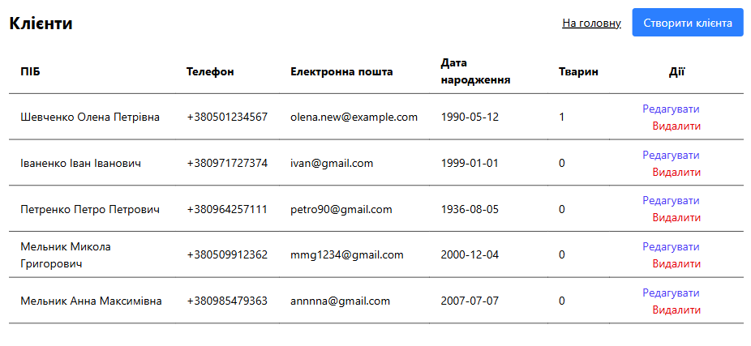
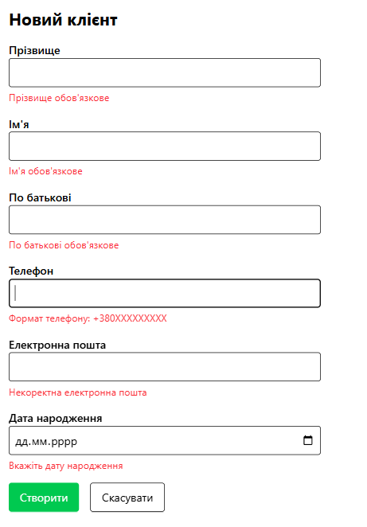
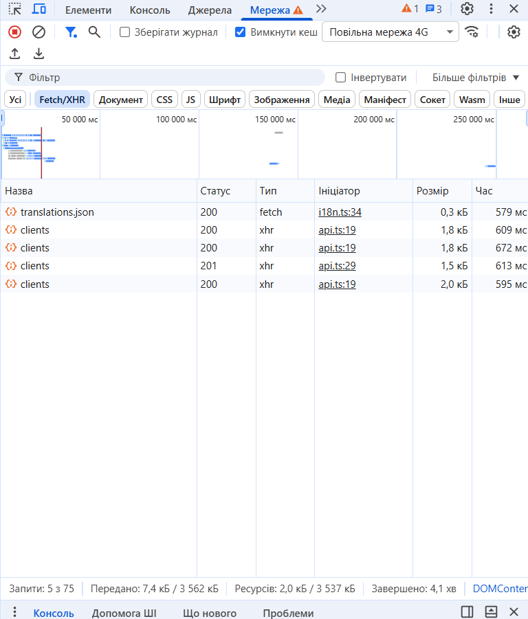
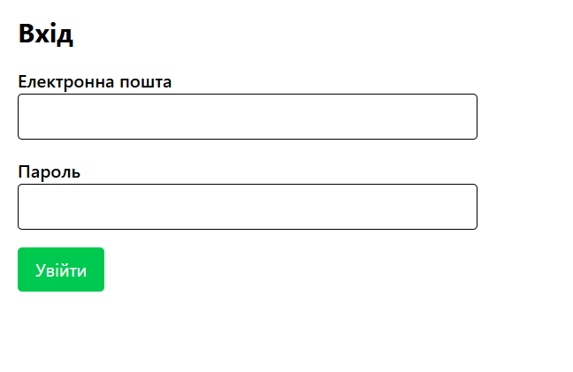

# VetClinic Frontend

Клієнтський застосунок для інформаційної системи «Ветеринарна клініка» (VetClinic IS). Працює з REST API з репозиторію [vetclinic-backend](https://github.com/FLEI-byte/vetclinic-backend). Проєкт створено на основі [vite-react-boilerplate](https://github.com/RicardoValdovinos/vite-react-boilerplate) у межах лабораторно-практичної роботи №8-9.

**Стек:** Vite, React, TypeScript, TanStack Router, TanStack Query, React Hook Form, Zod, Zustand, Axios, Tailwind CSS.

## Реалізований функціонал

Для кожної з чотирьох сутностей (клієнти, співробітники, медичні картки, прийоми) реалізовано повний CRUD:

- сторінка зі списком, індикатор завантаження, обробка помилок і видалення з підтвердженням;
- форма створення та форма редагування з валідацією на основі схеми Zod;
- у формах медичної картки й прийому зв'язані записи (власник, медична картка, співробітник) обираються зі списків, які завантажуються з API;
- сторінка входу `/login`, токен зберігається в Zustand і додається до кожного запиту Axios-інтерцептором.

Маршрути (файлова маршрутизація TanStack Router):

| Шлях | Сторінка |
| --- | --- |
| `/` | Головна з навігацією |
| `/login` | Вхід |
| `/clients`, `/clients/new`, `/clients/$clientId` | Клієнти: список, створення, редагування |
| `/employees`, `/employees/new`, `/employees/$employeeId` | Співробітники |
| `/medical-cards`, `/medical-cards/new`, `/medical-cards/$medicalCardId` | Медичні картки |
| `/appointments`, `/appointments/new`, `/appointments/$appointmentId` | Прийоми |

## Запуск

1. Запустити бекенд (інструкція в [vetclinic-backend](https://github.com/FLEI-byte/vetclinic-backend)): він має працювати на `http://localhost:4000`.

2. Встановити залежності:

   ```
   pnpm install
   ```

3. Створити файл `.env` за зразком `.env.example`:

   ```
   VITE_APP_ENVIRONMENT="development"
   VITE_API_BASE_URL="http://localhost:4000/v1"
   VITE_API_AUTH_TOKEN=""
   ```

   `VITE_API_AUTH_TOKEN` необов'язковий: це запасний токен для розробки, який можна отримати через `POST /v1/auth/login` у Postman. Файл `.env` не зберігається в git.

4. Запустити застосунок:

   ```
   npm run dev
   ```

Застосунок доступний на `http://localhost:5173`. Для входу використовується тестовий користувач бекенду `admin@admin.com` / `pass1`.

## Структура проєкту

```
src/
  lib/
    axios.ts            інстанс Axios та інтерцептори
    api-types.ts        формат відповіді бекенду
  store/
    authStore.ts        Zustand-стор з JWT-токеном
  components/forms/
    FormField.tsx       спільне текстове поле форми
    SelectField.tsx     спільне поле зі списком
  features/
    clients/            api.ts, types.ts, schema.ts, components/, pages/
    employees/          те саме
    medical-cards/      те саме
    appointments/       те саме, плюс utilities.ts
    auth/               api.ts, schema.ts, pages/LoginPage.tsx
    shared/types.ts     короткі типи (ClientShort тощо)
  routes/               файли маршрутів (лише Route, без компонентів)
  pages/Home.tsx        головна сторінка
```

## Ключовий код

### Конфігурація Axios

`src/lib/axios.ts`: окремий інстанс із базовою адресою API. Request-інтерцептор бере токен зі стору Zustand, а якщо його немає, то зі змінної середовища. Response-інтерцептор виводить помилки API в консоль.

```ts
import axios from "axios";
import { useAuthStore } from "@/store/authStore";

const apiClient = axios.create({
	baseURL: import.meta.env.VITE_API_BASE_URL,
	headers: {
		"Content-Type": "application/json",
	},
});

apiClient.interceptors.request.use((config) => {
	const token = useAuthStore.getState().token ?? import.meta.env.VITE_API_AUTH_TOKEN;
	if (token) {
		config.headers.set("Authorization", `Bearer ${token}`);
	}
	return config;
});

apiClient.interceptors.response.use(
	(response) => response,
	(error: unknown) => {
		if (axios.isAxiosError(error)) {
			console.error("API Error:", error.response?.data ?? error.message);
			return Promise.reject(error);
		}
		console.error("API Error:", error);
		return Promise.reject(error instanceof Error ? error : new Error(String(error)));
	},
);

export default apiClient;
```

### Хуки TanStack Query

`src/features/clients/api.ts`: функції запитів та хуки для сутності Client (для інших сутностей файли побудовано за тим самим зразком). Бекенд повертає `{ message, data }`, тому дані беруться з `response.data.data`, а оновлення виконується методом PATCH.

```ts
import {
	useMutation,
	useQuery,
	useQueryClient,
	type UseMutationResult,
	type UseQueryResult,
} from "@tanstack/react-query";
import { useNavigate } from "@tanstack/react-router";
import apiClient from "@/lib/axios";
import type { ApiResponse } from "@/lib/api-types";
import type { Client, ClientInput, ClientUpdateVariables } from "@/features/clients/types";

const getClients = async (): Promise<Array<Client>> => {
	const response = await apiClient.get<ApiResponse<Array<Client>>>("/clients");
	return response.data.data;
};

const getClientById = async (id: number): Promise<Client> => {
	const response = await apiClient.get<ApiResponse<Client>>(`/clients/${id}`);
	return response.data.data;
};

const createClient = async (newClient: ClientInput): Promise<Client> => {
	const response = await apiClient.post<ApiResponse<Client>>("/clients", newClient);
	return response.data.data;
};

const updateClient = async ({ id, data }: ClientUpdateVariables): Promise<Client> => {
	const response = await apiClient.patch<ApiResponse<Client>>(`/clients/${id}`, data);
	return response.data.data;
};

const deleteClient = async (id: number): Promise<void> => {
	await apiClient.delete(`/clients/${id}`);
};

export const useClients = (): UseQueryResult<Array<Client>> =>
	useQuery<Array<Client>>({ queryKey: ["clients"], queryFn: getClients });

export const useClient = (id: number): UseQueryResult<Client> =>
	useQuery<Client>({ queryKey: ["clients", id], queryFn: () => getClientById(id) });

export const useCreateClient = (): UseMutationResult<Client, Error, ClientInput> => {
	const queryClient = useQueryClient();
	const navigate = useNavigate();
	return useMutation({
		mutationFn: createClient,
		onSuccess: () => {
			void queryClient.invalidateQueries({ queryKey: ["clients"] });
			void navigate({ to: "/clients" });
		},
	});
};

export const useUpdateClient = (): UseMutationResult<Client, Error, ClientUpdateVariables> => {
	const queryClient = useQueryClient();
	const navigate = useNavigate();
	return useMutation({
		mutationFn: updateClient,
		onSuccess: (updatedClient) => {
			void queryClient.invalidateQueries({ queryKey: ["clients"] });
			queryClient.setQueryData(["clients", updatedClient.id], updatedClient);
			void navigate({ to: "/clients" });
		},
	});
};

export const useDeleteClient = (): UseMutationResult<void, Error, number> => {
	const queryClient = useQueryClient();
	return useMutation({
		mutationFn: deleteClient,
		onSuccess: () => {
			void queryClient.invalidateQueries({ queryKey: ["clients"] });
		},
	});
};
```

### Схема Zod

`src/features/clients/schema.ts`: правила збігаються з валідацією на бекенді (формат телефону, довжини полів, дата народження в минулому).

```ts
import { z } from "zod";

export const clientSchema = z.object({
	birth_date: z
		.string()
		.regex(/^\d{4}-\d{2}-\d{2}$/, "Вкажіть дату народження")
		.refine((value) => new Date(value) < new Date(), "Дата має бути в минулому"),
	email: z.email("Некоректна електронна пошта").max(255, "Не більше 255 символів"),
	first_name: z.string().trim().min(1, "Ім'я обов'язкове").max(30, "Не більше 30 символів"),
	last_name: z.string().trim().min(1, "Прізвище обов'язкове").max(30, "Не більше 30 символів"),
	patronymic: z.string().trim().min(1, "По батькові обов'язкове").max(30, "Не більше 30 символів"),
	phone: z.string().regex(/^\+380\d{9}$/, "Формат телефону: +380XXXXXXXXX"),
});

export type ClientFormData = z.infer<typeof clientSchema>;
```

## Скріншоти

### Сторінка зі списком сутностей

Список клієнтів, отриманий з API.



### Форма з помилками валідації Zod

Порожня форма створення клієнта після натискання кнопки «Створити».



### Вкладка Network у DevTools

Реальні HTTP-запити до `localhost:4000/v1/clients`: `GET` зі статусом 200 і `POST` зі статусом 201 (створення клієнта).



### Сторінка входу



## Особливості реалізації

- **Структура маршрутів.** Кожну сутність винесено в папку (`index`, `new`, `$id`), а не в пару `products.tsx` + `products.new.tsx`, як у прикладі методички: батьківський файл став би layout-маршрутом, і список довелося б показувати через `<Outlet />`. Компоненти сторінок лежать у `src/features/<сутність>/pages/`, а у файлах маршрутів залишено лише `Route`.
- **Формат відповідей.** Бекенд загортає дані в `{ message, data }`, тому в API-функціях використовується `response.data.data`. Для оновлення бекенд приймає PATCH, а не PUT.
- **ПІБ.** У відповідях ПІБ приходить одним полем `full_name`, а приймає бекенд три окремі поля. У формах редагування `full_name` розбивається по пробілах.
- **Aліас `@/`.** У шаблоні його не було, тому його додано в `vite.config.ts` і `tsconfig.json`.
- **Токен.** Токен із форми входу зберігається в Zustand і дублюється в `localStorage`, щоб переживати перезавантаження сторінки. Для реального застосунку такий спосіб зберігання небезпечний.

Повний покроковий опис виконання роботи зі скріншотами: [report_lab8.md](report_lab8.md).