# Лабораторно-практична робота №8-9

**Тема:** Full-stack інтеграція: розробка UI на базі професійного бойлерплейту.

**Мета:** пройти повний цикл розробки від проєктування інтерфейсу до його інтеграції з REST API: керувати серверним станом за допомогою TanStack Query, будувати форми з валідацією на основі React Hook Form та Zod, організувати навігацію за допомогою TanStack Router.

**Репозиторій фронтенду:** https://github.com/FLEI-byte/vetclinic-frontend

**Репозиторій бекенду (REST API з лабораторних робіт №5 і №6):** https://github.com/FLEI-byte/vetclinic-backend

Фронтенд створено на основі бойлерплейту `vite-react-boilerplate`, вивченого в лабораторній роботі №7. Для нього створено власний репозиторій: копію проєкту взято без папки `.git`, ініціалізовано новий git-репозиторій і виконано перший push. Реалізовано CRUD-інтерфейс для всіх чотирьох сутностей бекенду (клієнти, співробітники, медичні картки, прийоми) і сторінку входу.

---

## Етап 1. Налаштування проєкту та API-клієнта

1. Бекенд запущено на `http://localhost:4000`. Для зручності розробки термін дії JWT у `.env` бекенду збільшено до 7 днів. Цю зміну не закомічено.

2. **Крок 1-1. Встановлення Axios.** Виконано `pnpm add axios`, встановлено версію 1.21.0 (`pnpm add` є відповідником команди `pnpm install axios` з методички).

   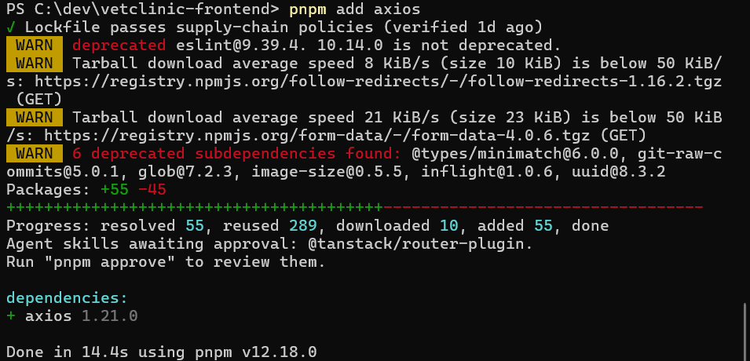

3. **Крок 1-2. Змінні оточення.** Створено файл `.env.example` (без токена), який зберігається в git:

   ```
   VITE_APP_ENVIRONMENT="development"
   VITE_API_BASE_URL="http://localhost:4000/v1"
   VITE_API_AUTH_TOKEN=""
   ```

   Файл `.env` містить ті самі змінні, а в `VITE_API_AUTH_TOKEN` вставлено токен, отриманий у Postman через запит Login. Оскільки репозиторій публічний, `.env` додано до `.gitignore` і прибрано з відстеження командою `git rm --cached .env` (шаблон помилково закомітив його з першим комітом, але секретів там тоді не було). У `src/environment.d.ts` додано типи нових змінних.

4. **Крок 1-3. Перевірка, що `.env` не потрапить у репозиторій.** Команда `git status` показує `.env` лише як видалений з відстеження, а `.env.example` і `src/lib/axios.ts` як нові файли.

   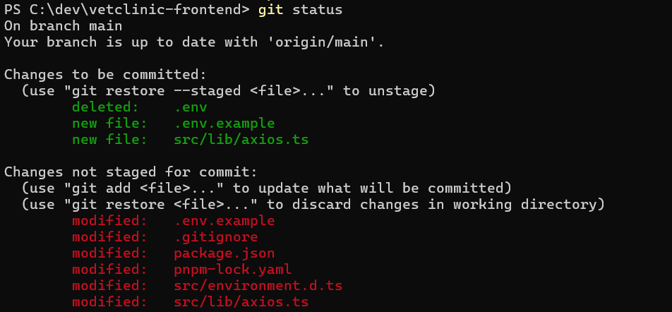

5. **Крок 1-4. Налаштування Axios.** Створено файл `src/lib/axios.ts`: інстанс із `baseURL` з `VITE_API_BASE_URL`, токен у заголовку `Authorization` та response-інтерцептор для обробки помилок. Код першої версії:

   ```ts
   import axios from "axios";

   const apiClient = axios.create({
   	baseURL: import.meta.env.VITE_API_BASE_URL,
   	headers: {
   		"Content-Type": "application/json",
   	},
   });

   const token = import.meta.env.VITE_API_AUTH_TOKEN;
   if (token) {
   	apiClient.defaults.headers.common["Authorization"] = `Bearer ${token}`;
   }

   apiClient.interceptors.response.use(
   	(response) => response,
   	(error: unknown) => {
   		if (axios.isAxiosError(error)) {
   			console.error("API Error:", error.response?.data ?? error.message);
   			return Promise.reject(error);
   		}
   		console.error("API Error:", error);
   		return Promise.reject(error instanceof Error ? error : new Error(String(error)));
   	},
   );

   export default apiClient;
   ```

   Ця версія змінена на етапі 5: токен тепер береться зі стору Zustand request-інтерцептором, а токен із `.env` залишився запасним варіантом.

6. **Крок 1-5. Коміт.** Зміни закомічено (`feat: add axios client and env configuration`) і запушено в GitHub.

**Результат етапу:** налаштовано змінні оточення та Axios-клієнт, токен не потрапляє в репозиторій.

---

## Етап 2. Організація роботи з API за допомогою TanStack Query

1. **Крок 2-1. Аліас `@/`.** Методичка використовує імпорти виду `@/lib/axios`, але в шаблоні аліасів не було. Аліас додано в `vite.config.ts` (`resolve.alias`) та в `tsconfig.json` (`paths`).

2. **Крок 2-2. Типи.** Створено формат відповіді бекенду (`src/lib/api-types.ts`: `{ message, data }`) та типи кожної сутності у `src/features/<сутність>/types.ts`. Для кожної сутності описано тип відповіді (відповідає ResponseDTO бекенду), тип вхідних даних (відповідає DTO) та тип змінних для мутації оновлення. Спільні короткі типи (`ClientShort`, `EmployeeShort` тощо) винесено в `src/features/shared/types.ts`.

3. **Крок 2-3. API-функції та хуки.** Для кожної сутності створено `src/features/<сутність>/api.ts` з функціями запитів і хуками `useXxx`, `useXxx(id)`, `useCreateXxx`, `useUpdateXxx`, `useDeleteXxx`. Відмінності від прикладу методички: бекенд повертає `{ message, data }`, тому беремо `response.data.data`; оновлення виконується методом `PATCH`, а не `PUT`. Фрагмент для сутності Client:

   ```ts
   const getClients = async (): Promise<Array<Client>> => {
   	const response = await apiClient.get<ApiResponse<Array<Client>>>("/clients");
   	return response.data.data;
   };

   const createClient = async (newClient: ClientInput): Promise<Client> => {
   	const response = await apiClient.post<ApiResponse<Client>>("/clients", newClient);
   	return response.data.data;
   };

   export const useClients = (): UseQueryResult<Array<Client>> =>
   	useQuery<Array<Client>>({ queryKey: ["clients"], queryFn: getClients });

   export const useCreateClient = (): UseMutationResult<Client, Error, ClientInput> => {
   	const queryClient = useQueryClient();
   	const navigate = useNavigate();
   	return useMutation({
   		mutationFn: createClient,
   		onSuccess: () => {
   			void queryClient.invalidateQueries({ queryKey: ["clients"] });
   			void navigate({ to: "/clients" });
   		},
   	});
   };
   ```

   Після створення, оновлення чи видалення запису кеш списку інвалідується (`invalidateQueries`), тож список оновлюється автоматично.

4. **Крок 2-4. Структура.** Файли для всіх чотирьох сутностей та спільні типи:

   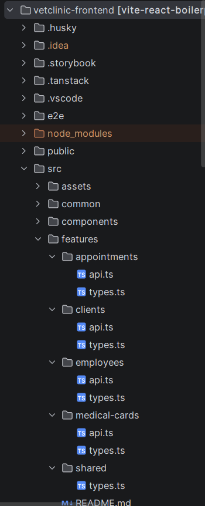

5. **Крок 2-5. Перевірка ESLint.** Налаштування проєкту вимагало виправлень: замість `Appointment[]` використовується `Array<Appointment>`, у кожної функції й хука явно вказано тип, що вона повертає, а імпорти з `@tanstack/react-query` об'єднано в один рядок. Виправлення закомічено окремим комітом (`fix: resolve eslint errors in api hooks and types`).

**Результат етапу:** для кожної сутності є типи й хуки TanStack Query, компоненти не використовують `useState` + `useEffect` для даних із сервера.

---

## Етап 3. Налаштування маршрутизації за допомогою TanStack Router

1. **Крок 3-1. Структура маршрутів.** Для кожної сутності створено папку маршрутів із трьома файлами: список (`index.tsx`), створення (`new.tsx`) і редагування (`$<сутність>Id.tsx`). Структуру у вигляді папок обрано замість пари `products.tsx` + `products.new.tsx` з методички: в TanStack Router файл `products.tsx` став би батьківським layout-маршрутом для `products.new` і `products/$productId`, а список довелося б показувати через `<Outlet />`.

   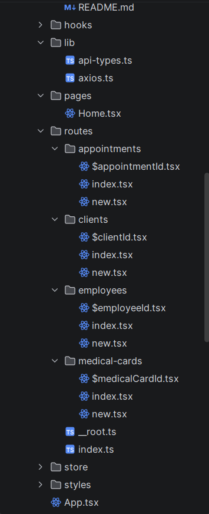

2. **Крок 3-2. Заглушки сторінок.** На цьому етапі кожен файл маршруту містить `createFileRoute` і просту заглушку, яку наповнено на етапі 4. Приклад:

   ```tsx
   export const Route = createFileRoute("/clients/")({
   	component: ClientsListPage,
   });
   ```

3. **Крок 3-3. Головна сторінка з навігацією.** У `src/pages/Home.tsx` додано посилання на чотири розділи.

   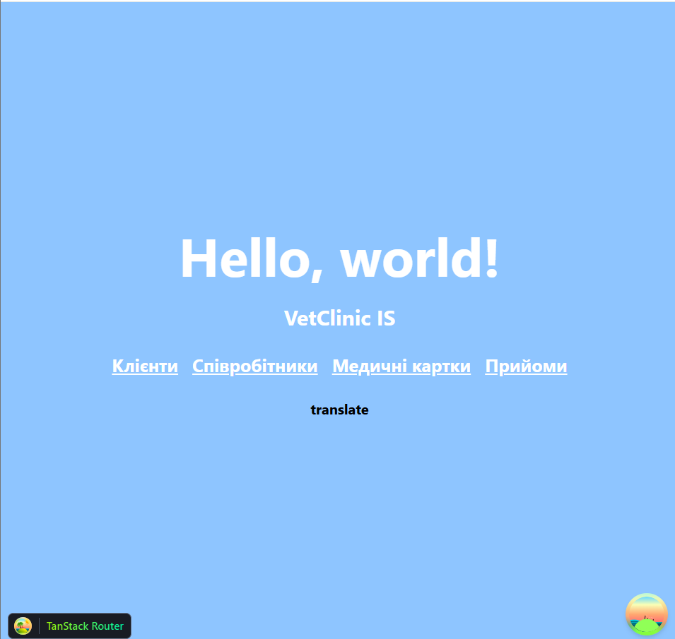

4. **Крок 3-4. Генерація дерева маршрутів.** Файл `routeTree.gen.ts` формується автоматично, коли працює dev-сервер (`npm run dev`). Після цього TypeScript знає про нові маршрути, а помилки `TS2322` про `to: "/clients"` тощо зникли.

5. **Крок 3-5. Перевірка в браузері.** Усі чотири посилання працюють. Сторінка-заглушка `/clients/new`:

   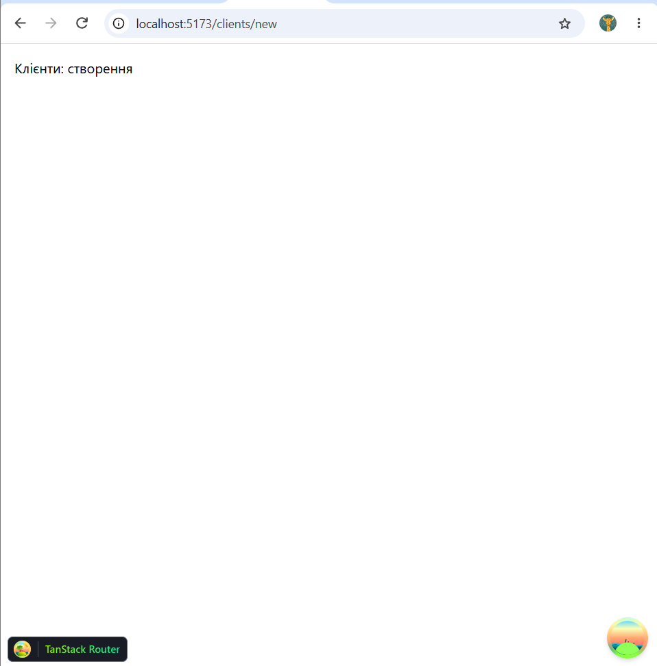

6. **Крок 3-6. Коміт.** Маршрути закомічено (`feat: add TanStack Router routes for all entities`) і запушено.

   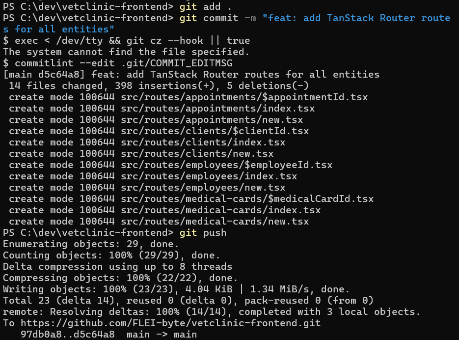

**Результат етапу:** створено 12 маршрутів для чотирьох сутностей, навігація працює.


---

## Етап 4. Реалізація UI для CRUD-операцій

Для кожної сутності створено сторінку списку, форму створення й форму редагування. Компоненти сторінок винесено з файлів маршрутів у `src/features/<сутність>/pages/`, у файлах маршрутів залишено лише `Route`. Форми створення й редагування використовують один спільний компонент, щоб не дублювати код. Спільні поля форм винесено в `src/components/forms/` (`FormField.tsx`, `SelectField.tsx`).

### 4.1. Клієнти (Client)

1. **Крок 4-1. Схема Zod.** Створено `src/features/clients/schema.ts`. Правила взято з валідації на бекенді: формат телефону `+380XXXXXXXXX`, довжини полів не більше 30 символів, коректна пошта, дата народження в минулому:

   ```ts
   export const clientSchema = z.object({
   	birth_date: z
   		.string()
   		.regex(/^\d{4}-\d{2}-\d{2}$/, "Вкажіть дату народження")
   		.refine((value) => new Date(value) < new Date(), "Дата має бути в минулому"),
   	email: z.email("Некоректна електронна пошта").max(255, "Не більше 255 символів"),
   	first_name: z.string().trim().min(1, "Ім'я обов'язкове").max(30, "Не більше 30 символів"),
   	last_name: z.string().trim().min(1, "Прізвище обов'язкове").max(30, "Не більше 30 символів"),
   	patronymic: z.string().trim().min(1, "По батькові обов'язкове").max(30, "Не більше 30 символів"),
   	phone: z.string().regex(/^\+380\d{9}$/, "Формат телефону: +380XXXXXXXXX"),
   });
   ```

2. **Крок 4-2. Форма.** Створено `ClientForm.tsx` на базі React Hook Form з `zodResolver`. Помилки валідації виводяться під полями, під час відправлення кнопка блокується (`isPending`), помилка сервера показується під формою.

3. **Крок 4-3. Сторінка списку.** `ClientsListPage.tsx` використовує хуки `useClients` та `useDeleteClient`. Поки дані завантажуються (`isLoading`), показується напис «Завантаження...», у разі помилки (`isError`) виводиться її текст. Видалення виконується після підтвердження через `window.confirm`. На локальному бекенді індикатор завантаження показується менше секунди, тому окремого скріншота з ним немає.

4. **Крок 4-4. Сторінки створення й редагування.** `ClientNewPage.tsx` використовує `useCreateClient`, `ClientEditPage.tsx` використовує `useClient` та `useUpdateClient`. Бекенд повертає ПІБ одним полем `full_name`, а приймає три окремі поля, тому у формі редагування `full_name` розбивається по пробілах на прізвище, ім'я та по батькові.

5. **Крок 4-5. Список клієнтів із даними з API.**

   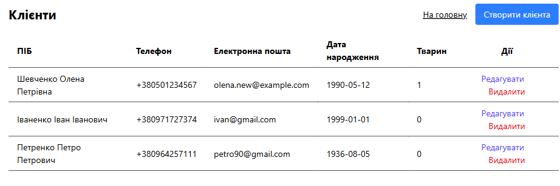

6. **Крок 4-6. Валідація Zod.** Після натискання «Створити» з порожньою формою під кожним полем з'являється повідомлення про помилку.

   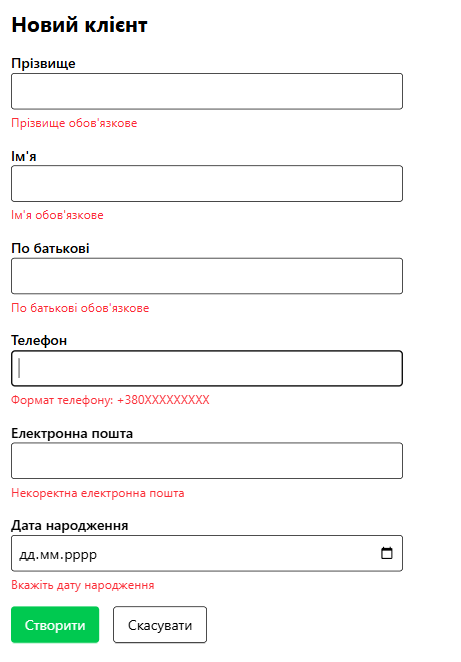

7. **Крок 4-7. Створення клієнта.** Форма з коректними даними:

   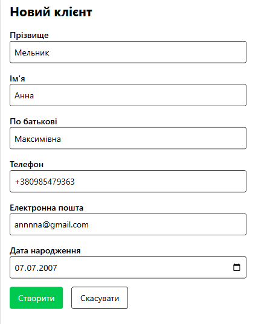

   Після відправлення відбувається перехід на список, де новий клієнт з'явився:

   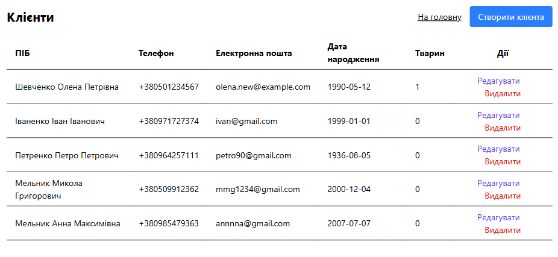

8. **Крок 4-8. Реальні HTTP-запити.** У вкладці Network (фільтр Fetch/XHR, кеш вимкнено) видно запити `clients` зі статусом 200 і запит із статусом 201, що відповідає створенню клієнта. Ініціатором запитів є `api.ts`, тобто хуки TanStack Query.

   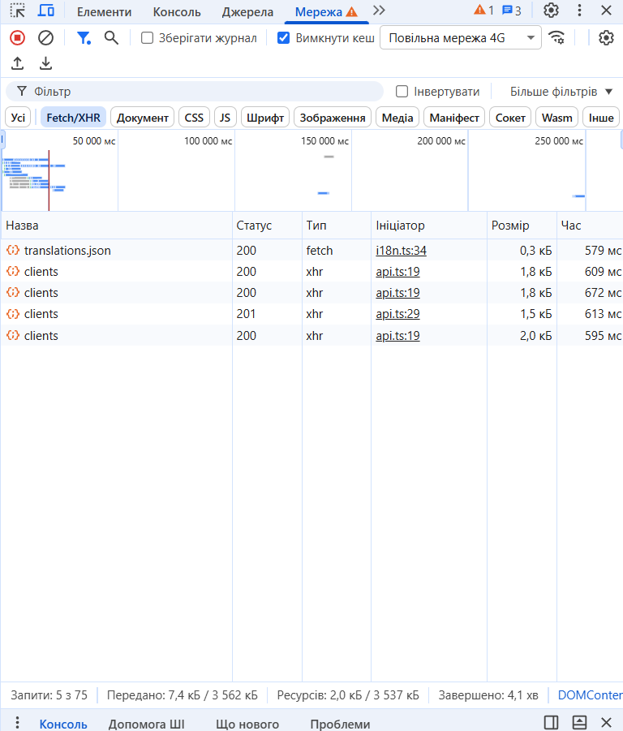

9. **Крок 4-9. Редагування.** Форма редагування відкривається із заповненими даними клієнта. Змінено пошту й збережено:

   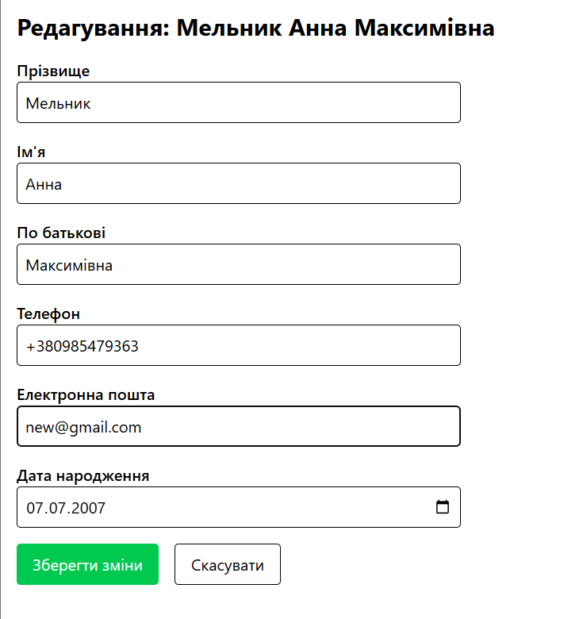

10. **Крок 4-10. Видалення.** Перед видаленням браузер просить підтвердження:

    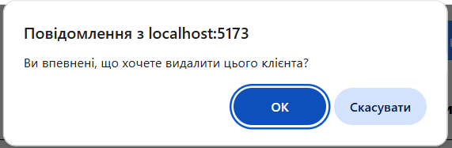

    Після підтвердження список оновлюється, клієнта в ньому більше немає:

    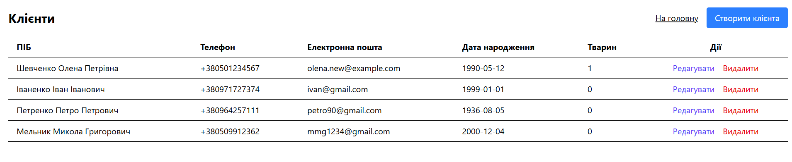

11. **Крок 4-11. Коміт.** Зміни закомічено (`feat: add clients CRUD UI with zod validation`) і запушено.

    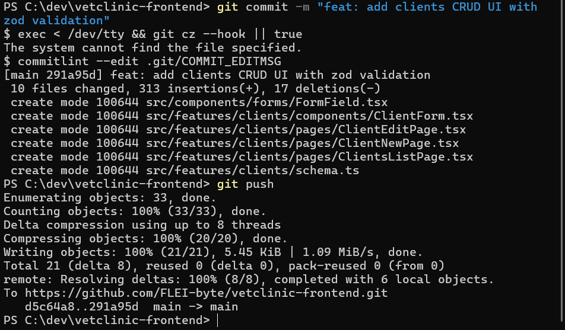

**Результат підетапу:** повний CRUD клієнтів працює через TanStack Query, форми валідуються схемою Zod.

### 4.2. Співробітники (Employee)

1. **Крок 4-12. Реалізація.** За зразком Client створено `schema.ts` (додано поле `position` не більше 50 символів), `EmployeeForm.tsx`, три сторінки (`EmployeesListPage`, `EmployeeNewPage`, `EmployeeEditPage`) та оновлено три файли маршрутів.

2. **Крок 4-13. Список співробітників.** Таблиця містить ПІБ, посаду, телефон, пошту та кількість прийомів (вкладені дані з API):

   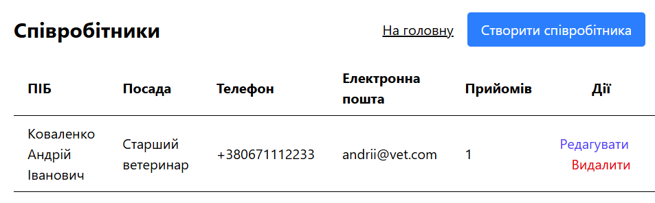

3. **Крок 4-14. Валідація Zod.** Порожні поля та неправильний телефон `123` викликають повідомлення про помилки:

   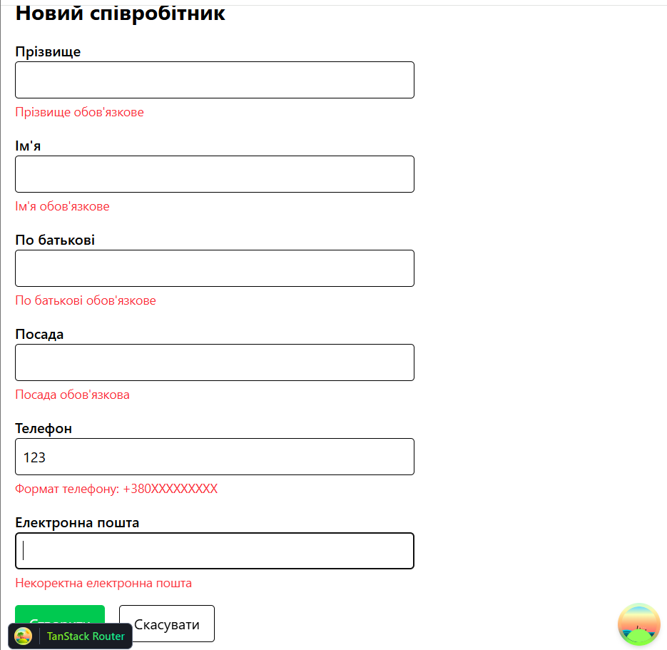

4. **Крок 4-15. Створення співробітника.** Після створення новий співробітник з'явився у списку:

   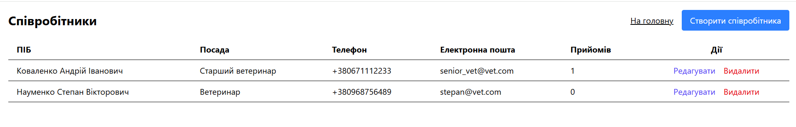

5. **Крок 4-16. Коміт.** `feat: add employees CRUD UI with zod validation`.

   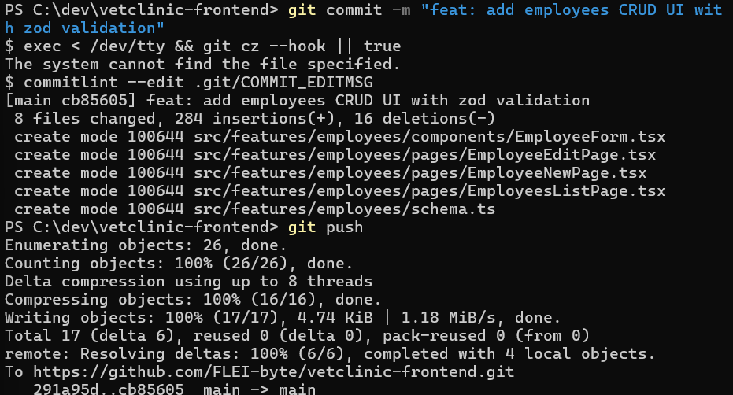

**Результат підетапу:** CRUD співробітників працює за тим самим шаблоном.

### 4.3. Медичні картки (MedicalCard)

У формі медичної картки з'явилися два випадаючі списки: власник (список клієнтів із хука `useClients`) і стать (`чоловіча` / `жіноча`, як вимагає бекенд). Для цього створено спільний компонент `SelectField.tsx`. Значення `<select>` є рядками, тому `client_id` у схемі має тип `string` і перетворюється на число перед відправленням на сервер.

1. **Крок 4-18. Реалізація.** Створено `schema.ts`, `MedicalCardForm.tsx`, три сторінки та оновлено три файли маршрутів.

2. **Крок 4-19. Список карток.** Показує кличку, вид, породу, стать, дату народження, власника (вкладений об'єкт `client`) та кількість прийомів:

   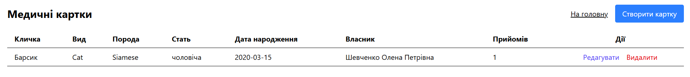

3. **Крок 4-20. Валідація Zod.** Форма з помилками, зокрема «Оберіть стать»:

   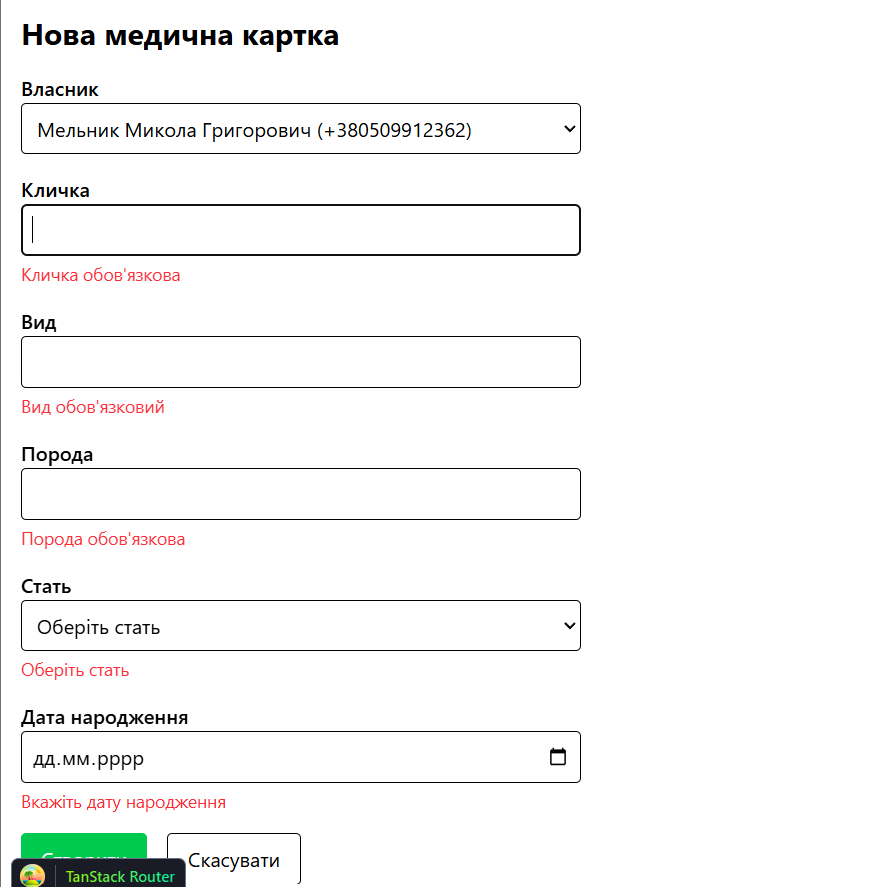

4. **Крок 4-21. Вибір власника.** Випадаючий список заповнюється клієнтами, отриманими з API:

   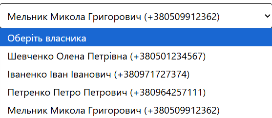

5. **Крок 4-22. Створення картки.** У списку з'явилася нова картка з власником:

   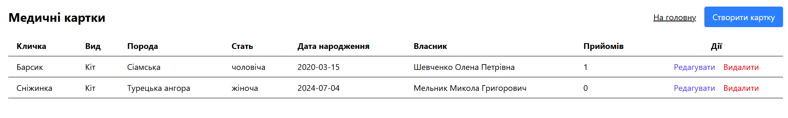

6. **Крок 4-23. Коміт.** Під час перевірки було виявлено, що у файлі `src/routes/medical-cards/new.tsx` помилково підставлено компонент редагування, а `$medicalCardId.tsx` лишився заглушкою з етапу 3. Це виправлено окремим комітом (`feat: add medical cards CRUD UI with zod validation`).

   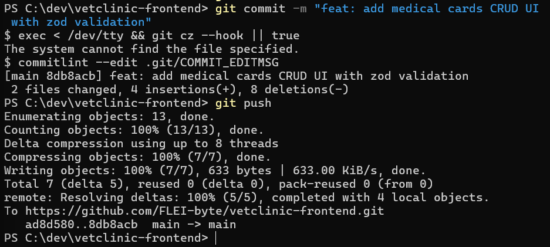

**Результат підетапу:** CRUD медичних карток працює, форма використовує дані пов'язаної сутності.

### 4.4. Прийоми (Appointment)

У формі прийому два випадаючі списки (медична картка зі списком власників і співробітник), поле дати й часу (`datetime-local`), мета звернення, результати огляду, діагноз і сума. Усі значення форми є рядками, тому перед відправленням у `utilities.ts` виконується перетворення: ідентифікатори стають числами, дата переводиться в ISO-формат (`toISOString`), сума в число. При відкритті редагування виконується зворотне перетворення дати.

1. **Крок 4-25. Реалізація.** Створено `schema.ts` (сума має бути числом більше 0), `utilities.ts` (перейменовано з `utils.ts` через правило `unicorn/prevent-abbreviations`), `AppointmentForm.tsx`, три сторінки та оновлено три файли маршрутів.

2. **Крок 4-26. Список прийомів.** Таблиця показує дату й час, тварину, власника, ветеринара, мету, діагноз і суму. Дані про тварину, власника й ветеринара приходять вкладеними об'єктами (join на бекенді):

   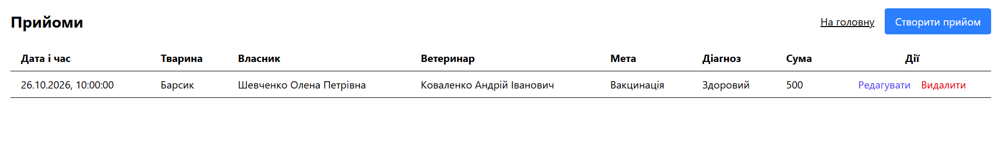

3. **Крок 4-27. Валідація Zod.** Помилки для порожніх списків, дати, мети й суми:

   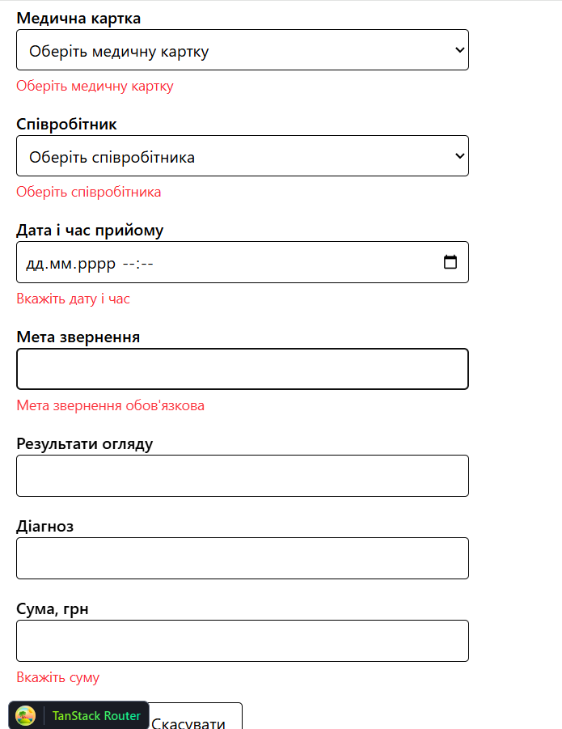

4. **Крок 4-28. Створення прийому.** Новий прийом (Сніжинка, Науменко Степан, 850) з'явився у списку:

   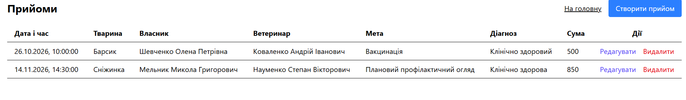

5. **Крок 4-29. Коміт.** `feat: add appointments CRUD UI with zod validation`. Також окремим комітом видалено випадково створену копію `AppointmentForm.tsx` у папці `clients`.

   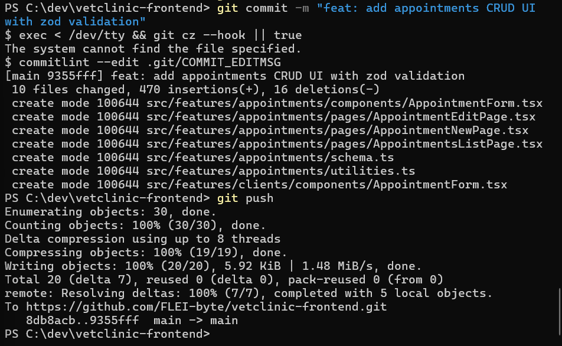

**Результат підетапу:** CRUD прийомів працює, усі чотири сутності мають повний інтерфейс.

**Результат етапу:** для всіх сутностей реалізовано список, створення, редагування й видалення. Дані завантажуються через TanStack Query, форми валідуються схемами Zod, навігація працює через TanStack Router. ESLint і `tsc` по всьому проєкту проходять без помилок.


---

## Етап 5. Реалізація UI для логіну (опціонально)

1. **Крок 5-1. Zustand-стор.** Створено `src/store/authStore.ts`. Стор зберігає JWT-токен і має методи `setToken` та `clearToken`. Токен дублюється в `localStorage`, щоб переживати перезавантаження сторінки, а всі звернення до сховища обгорнуто в `try/catch`:

   ```ts
   export const useAuthStore = create<AuthState>((set) => ({
   	clearToken: (): void => {
   		try {
   			localStorage.removeItem(STORAGE_KEY);
   		} catch {
   			// сховище недоступне, токен лишається лише в пам'яті
   		}
   		set({ token: null });
   	},
   	setToken: (token): void => {
   		try {
   			localStorage.setItem(STORAGE_KEY, token);
   		} catch {
   			// сховище недоступне, токен лишається лише в пам'яті
   		}
   		set({ token });
   	},
   	token: readStoredToken(),
   }));
   ```

2. **Крок 5-2. Axios бере токен зі стору.** У `src/lib/axios.ts` замість статичного заголовка додано request-інтерцептор. Він щоразу читає токен зі стору Zustand, а якщо токена немає, використовує `VITE_API_AUTH_TOKEN` із `.env`:

   ```ts
   apiClient.interceptors.request.use((config) => {
   	const token = useAuthStore.getState().token ?? import.meta.env.VITE_API_AUTH_TOKEN;
   	if (token) {
   		config.headers.set("Authorization", `Bearer ${token}`);
   	}
   	return config;
   });
   ```

3. **Крок 5-3. Схема й мутація входу.** Створено схему Zod `loginSchema` (коректна пошта, непорожній пароль) і мутацію `useLogin` у `src/features/auth/api.ts`. Бекенд повертає токен рядком виду `Bearer <jwt>`, тому префікс прибирається перед збереженням у стор. Після успішного входу токен записується в Zustand і виконується перехід на головну:

   ```ts
   const login = async (credentials: LoginFormData): Promise<string> => {
   	const response = await apiClient.post<ApiResponse<string>>("/auth/login", credentials);
   	return response.data.data.replace("Bearer ", "");
   };

   export const useLogin = (): UseMutationResult<string, Error, LoginFormData> => {
   	const setToken = useAuthStore((state) => state.setToken);
   	const navigate = useNavigate();
   	return useMutation({
   		mutationFn: login,
   		onSuccess: (token) => {
   			setToken(token);
   			void navigate({ to: "/" });
   		},
   	});
   };
   ```

4. **Крок 5-4. Сторінка входу.** Створено маршрут `/login` і компонент `LoginPage.tsx` із формою на React Hook Form (поля «Електронна пошта» та «Пароль»). На головній сторінці додано посилання «Увійти», яке після входу змінюється на кнопку «Вийти» (вона викликає `clearToken`).

   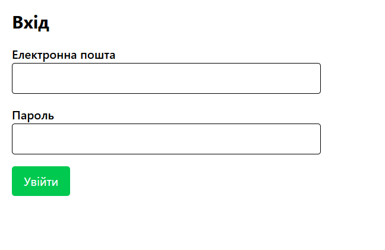

5. **Крок 5-5. Валідація.** Порожня форма викликає помилки Zod:

   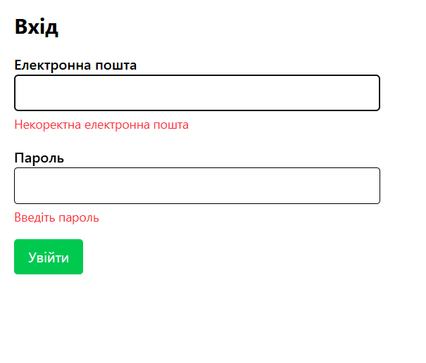

6. **Крок 5-6. Помилка входу.** При неправильному паролі сервер повертає помилку, і вона виводиться під формою. У нашому випадку бекенд відповів статусом 404:

   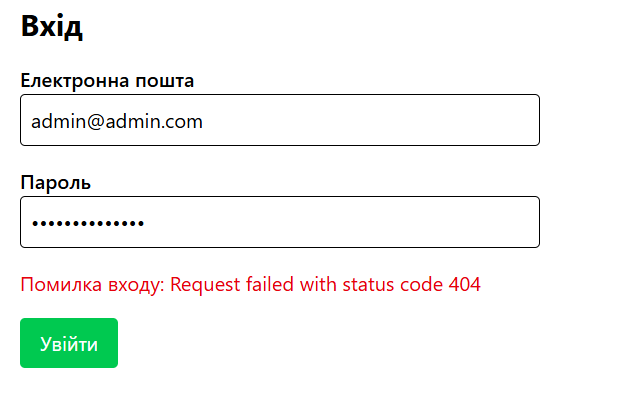

7. **Крок 5-7. Успішний вхід.** Після введення `admin@admin.com` і правильного пароля відбувся перехід на головну сторінку, де замість «Увійти» з'явилася кнопка «Вийти»:

   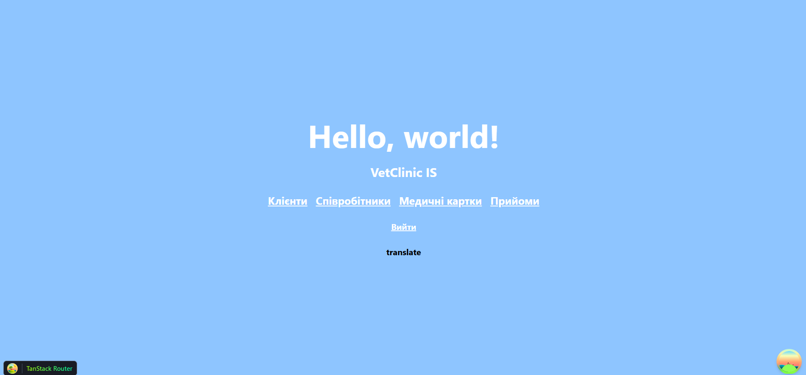

8. **Крок 5-8. Коміт.** `feat: add login page with zustand token store`.

   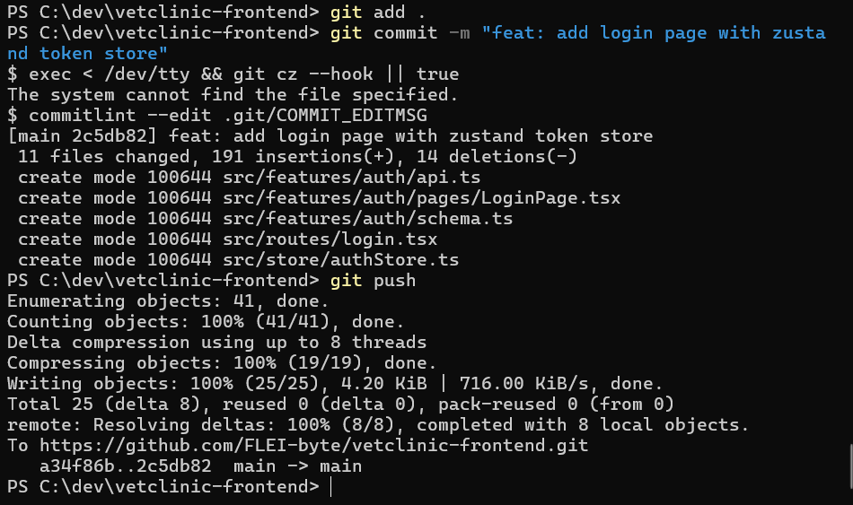

**Результат етапу:** реалізовано вхід через форму, токен зберігається в Zustand і автоматично додається до всіх запитів до API.

---

## Особливості реалізації та проблеми

1. **Окремий репозиторій.** Бойлерплейт клоновано з чужого репозиторію, тому для фронтенду створено новий: проєкт скопійовано без `.git` і `node_modules` (`robocopy`), виконано `git init` та перший push у `vetclinic-frontend`.

2. **Файл `.env` у git.** Шаблон не мав `.env.example`, а `.env` потрапив у перший коміт. Оскільки репозиторій публічний, а в `.env` має зберігатися токен, файл додано до `.gitignore`, прибрано з відстеження (`git rm --cached`) і створено `.env.example`.

3. **Термін дії токена.** JWT на бекенді діє 15 хвилин, що незручно під час розробки, коли токен вставляється в `.env` вручну. На час роботи `JWT_EXPIRATION` у `.env` бекенду збільшено до 7 днів. Цю зміну не комітилось у репозиторій бекенду. Після завершення роботи значення повертається до початкового.

4. **Аліас `@/`.** Методичка використовує імпорти `@/lib/axios`, але в шаблоні аліасів не було. Додано `resolve.alias` у `vite.config.ts` та `paths` у `tsconfig.json`.

5. **Формат відповідей і метод оновлення.** Бекенд повертає `{ message, data }`, тому в прикладі з методички `response.data` замінено на `response.data.data`. Оновлення в API виконується методом `PATCH`, а не `PUT`.

6. **ПІБ.** Бекенд у відповідях об'єднує ПІБ у поле `full_name`, а при створенні й оновленні приймає три окремі поля. Для форм редагування `full_name` розбивається по пробілах.

7. **Дата й час прийому.** Поле `datetime-local` повертає рядок без часового поясу, а бекенд очікує коректну дату. Перед відправленням дата перетворюється в ISO-формат, а при редагуванні виконується зворотне перетворення. Сума з форми (рядок) перетворюється в число, також допускається кома як десятковий роздільник.

8. **Структура маршрутів.** Пара `products.tsx` + `products.new.tsx` з методички створює батьківський layout-маршрут, тому використано структуру папок (`clients/index.tsx`, `clients/new.tsx`, `clients/$clientId.tsx`). Компоненти сторінок винесено в `features/<сутність>/pages`, а це прибрало попередження `react-refresh/only-export-components` у файлах маршрутів.

9. **Правила ESLint.** Налаштування проєкту виявилися суворішими за приклади методички:
   - `array-type`: `Array<T>` замість `T[]`;
   - `explicit-function-return-type`: явні типи, що повертаються;
   - `no-duplicate-imports`: імпорти з `@tanstack/react-query` об'єднано в один рядок;
   - `camelcase`: поля API (`first_name`, `birth_date`) мають підкреслення, тому правило змінено на `["error", { "properties": "never" }]` в `eslint.config.js`;
   - `react/jsx-sort-props`: порядок пропсів JSX (виправляється `eslint --fix`);
   - `unicorn/prevent-abbreviations`: файл `utils.ts` перейменовано на `utilities.ts` (така сама вимога була в лабораторній роботі №7);
   - `prefer-promise-reject-errors`: у response-інтерцепторі Axios помилки перед `Promise.reject` перетворюються на `Error`.

10. **Помилки під час створення файлів.** Під час виконання виявлено кілька помилок, пов'язаних зі створенням файлів: у `routes/medical-cards/new.tsx` було підключено компонент редагування замість компонента створення, а файли `$medicalCardId.tsx` та `$appointmentId.tsx` лишалися заглушками з етапу 3. Файли `AppointmentForm.tsx` і `auth/schema.ts` на певний момент не були створені, через що `tsc` повідомляв про відсутні модулі. Також випадково з'явилася зайва копія `AppointmentForm.tsx` у папці `clients`, її видалено. Такі помилки виявлялися командами `npx tsc --noEmit` і `npx eslint src`, після чого виправлялися.

11. **Індикатор завантаження.** У коді списків він реалізований через `isLoading`, але на локальному бекенді запити виконуються за долі секунди, тому зафіксувати його на скріншоті не вдалося.

12. **Вхід.** Під час спроби входу з неправильним паролем бекенд повернув статус 404, і ця помилка потрапила у форму входу. Це спостереження за поведінкою бекенду, а не помилка фронтенду.

13. **Зберігання токена.** Токен зберігається в `localStorage`, щоб вхід не губився після перезавантаження сторінки. Для реального застосунку такий спосіб небезпечний (токен доступний будь-якому скрипту сторінки), тут його використано для навчального проєкту.

14. **Husky і Windows.** При кожному коміті виводиться повідомлення `The system cannot find the file specified` від хука Commitizen, який очікує термінал Linux. На результат коміту воно не впливає, перевірку commitlint коміти проходять.

---

## Висновок

У ході лабораторної роботи створено повноцінний клієнтський застосунок для REST API з лабораторних робіт №5 і №6. Налаштовано Axios-клієнт зі змінними оточення та інтерцепторами. Робота із сервером організована через TanStack Query: для кожної з чотирьох сутностей створено типізовані хуки запитів і мутацій, а кеш оновлюється автоматично після змін. Навігацію реалізовано файловою маршрутизацією TanStack Router. Форми створення й редагування побудовано на React Hook Form зі схемами Zod, правила яких узгоджені з валідацією бекенду. Додатково реалізовано сторінку входу, а токен зберігається в Zustand і додається до запитів Axios-інтерцептором.

Основні труднощі були пов'язані з відмінностями між прикладами методички та реальним бекендом (формат відповідей, метод PATCH, поле `full_name`, формат дати), а також із суворими правилами ESLint у шаблоні. Результат закомічено у власний репозиторій `vetclinic-frontend`.